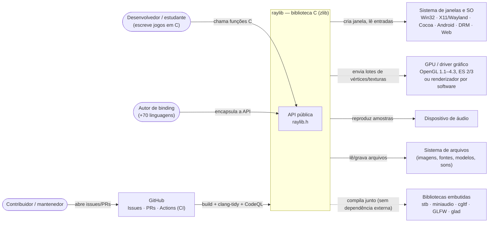
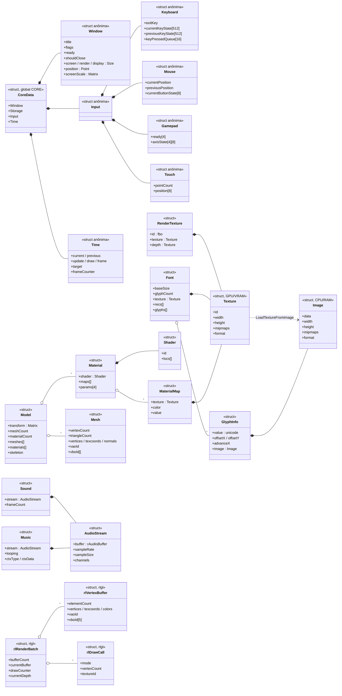
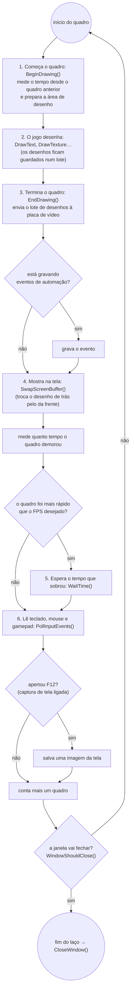
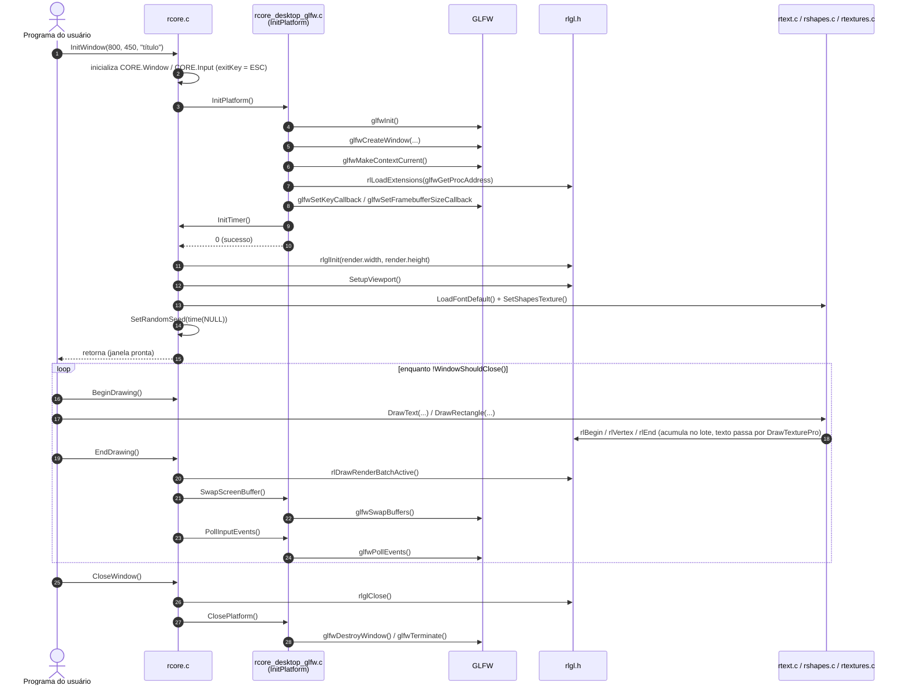

# 4 — UML e compreensão do sistema

## Em palavras simples

**UML** é uma forma padronizada de **desenhar um software** para entendê-lo antes de mexer nele. Fizemos 5 desenhos, e cada um responde a uma pergunta diferente:

| Diagrama | Pergunta que ele responde |
|---|---|
| 4.1 Contexto | Quem usa o raylib, e com o que ele conversa para funcionar? |
| 4.2 Classes | Que "moldes de dados" existem dentro dele? |
| 4.3 Pacotes | Como o código está dividido em pedaços? |
| 4.4 Atividades | O que acontece a cada quadro de um jogo? |
| 4.5 Sequência | Em que ordem as funções são chamadas ao abrir a janela? |

**Um detalhe importante:** o raylib é escrito em **C**, que não tem "classes". Por isso cada `struct` (um molde de dados do C) aparece no diagrama de classes como uma classe.

**Mini-glossário** (para explicar sem tropeçar):
- **Back-end de plataforma:** a parte do código que fala com o sistema operacional para abrir a janela (GLFW, SDL, Android, Web…). Só um é usado em cada compilação.
- **CPU e GPU:** o processador comum e a placa de vídeo. Uma `Image` fica na memória do processador, e uma `Texture` fica na placa de vídeo.
- **Lote (batch):** em vez de mandar cada desenho para a placa de vídeo, o raylib junta vários e manda de uma vez, o que é mais rápido.
- **Buffer / troca de buffers:** o jogo desenha numa tela "escondida" e, quando termina, troca com a que está visível, para você não ver o desenho pela metade.
- **Macro:** uma chave do compilador (como `PLATFORM_DESKTOP_GLFW`) que escolhe quais pedaços do código entram no programa.

Cada diagrama abaixo começa com uma explicação em palavras simples, seguida de como lê-lo. Todos estão ligados ao código na tabela final.

## 4.1 Diagrama de contexto

Mostra o raylib como caixa-preta, seus usuários e os sistemas externos com os quais interage.

**Em palavras simples:** o raylib é a caixa do meio. De um lado ficam as **pessoas** que o usam: quem escreve jogos, quem cria uma "ponte" para outra linguagem (o autor de binding) e quem contribui com o projeto pelo GitHub. Do outro lado ficam as **coisas com que ele conversa** para funcionar: o sistema operacional (que abre a janela), a placa de vídeo, o som e os arquivos. A linha tracejada mostra que as bibliotecas externas já vêm embutidas, então quem usa o raylib não precisa instalar mais nada.

**Como ler:** cada seta diz "quem pede alguma coisa a quem".

---

## 4.2 Diagrama de classes

Recorte das **estruturas de dados centrais**: estado global do núcleo, recursos gráficos/modelos/áudio e o lote de renderização do `rlgl`.

**Em palavras simples:** mostra os "moldes de dados" mais importantes do raylib e como eles se encaixam. Eles formam 5 grupos:
1. **Estado do jogo:** o `CoreData` (a variável global `CORE`) guarda a janela, o teclado, o mouse, o gamepad e o tempo.
2. **Imagens e texto:** a `Image` fica no processador, a `Texture` fica na placa de vídeo, e a `Font` usa uma textura mais as informações de cada letra (`GlyphInfo`).
3. **Modelos 3D:** um `Model` tem várias malhas (`Mesh`) e materiais (`Material`).
4. **Áudio:** `Sound` e `Music` são construídos sobre um `AudioStream`.
5. **Lote de desenho:** o `rlRenderBatch` junta vários desenhos antes de mandá-los à placa de vídeo.

**Como ler as setas:**
- losango **cheio** (`*--`): "é composto por", e a parte não existe sem o todo. Ex.: o `CoreData` contém a `Window`.
- losango **vazio** (`o--`): "tem vários", mas as partes existem sozinhas. Ex.: um `Model` tem vários `Mesh`.
- seta **tracejada** (`..>`): "vem de" ou "depende de". Ex.: uma `Texture` é criada a partir de uma `Image`.

É um **recorte**, e não o sistema inteiro.

---

## 4.3 Diagrama de pacotes

Módulos de `src/` e dependências por `#include`. Subgrafos representam **pacotes**; setas = "usa/inclui".
O `rcore.c` escolhe **um** back-end de plataforma por macro (`PLATFORM_*`).

**Em palavras simples:** é um mapa dos arquivos de `src/` e de quem usa quem (cada seta é um `#include`). Três ideias para guardar:
- O **núcleo** (`rcore.c`) cuida de janela, entrada, tempo e arquivos. Em cada compilação ele escolhe **uma** plataforma (GLFW no computador, SDL, Android, Web…).
- Os **módulos** de formas, texturas, texto, modelos e áudio são **opcionais**: dá para desligar o que não se usa e deixar o programa menor.
- As **bibliotecas de terceiros** ficam embutidas na pasta `external/`.

**Como ler:** cada caixa grande é um pacote (um grupo de arquivos), e cada seta diz "este arquivo usa aquele".

```mermaid
flowchart TB
    subgraph PUB["«package» API pública"]
        raylibh["raylib.h"]
        cfg["config.h<br/>(flags SUPPORT_*)"]
    end

    subgraph CORE["«package» núcleo"]
        rcore["rcore.c<br/>janela · entrada · tempo · arquivos · hash"]
        subgraph PLAT["«package» platforms/ (1 por build)"]
            glfwp["rcore_desktop_glfw.c"]
            sdlp["rcore_desktop_sdl.c"]
            rgfwp["rcore_desktop_rgfw.c"]
            winp["rcore_desktop_win32.c"]
            webp["rcore_web*.c"]
            drmp["rcore_drm.c"]
            andp["rcore_android.c"]
            memp["rcore_memory.c"]
        end
    end

    subgraph MODS["«package» módulos opcionais (SUPPORT_MODULE_*)"]
        rshapes["rshapes.c"]
        rtextures["rtextures.c"]
        rtext["rtext.c"]
        rmodels["rmodels.c"]
        raudio["raudio.c"]
    end

    subgraph HDR["«package» cabeçalhos internos reutilizáveis"]
        rlgl["rlgl.h<br/>abstração OpenGL"]
        raymath["raymath.h"]
        rcamera["rcamera.h"]
        rgestures["rgestures.h"]
    end

    subgraph EXT["«package» external/ (embutido)"]
        glfw["GLFW (via rglfw.c)"]
        glad["glad.h"]
        rlsw["rlsw.h<br/>renderizador por software"]
        stb["stb_image · stb_truetype<br/>stb_rect_pack · stb_image_write"]
        loaders["cgltf · tinyobj · m3d<br/>par_shapes · vox_loader"]
        audlibs["miniaudio · dr_wav/mp3/flac<br/>stb_vorbis · qoa · jar_xm/mod"]
    end

    rcore --> raylibh
    rcore --> cfg
    rcore --> rlgl
    rcore --> raymath
    rcore --> rcamera
    rcore --> rgestures
    rcore -->|"#include por macro"| PLAT
    glfwp --> glfw
    rshapes --> rlgl
    rtextures --> rlgl
    rtextures --> stb
    rtext --> rlgl
    rtext --> stb
    rmodels --> rlgl
    rmodels --> raymath
    rmodels --> loaders
    raudio --> audlibs
    rlgl --> glad
    rlgl -->|"GRAPHICS_API_OPENGL_SOFTWARE"| rlsw
    rshapes --> raylibh
    rtextures --> raylibh
    rtext --> raylibh
    rmodels --> raylibh
    raudio --> raylibh
```

---

## 4.4 Diagrama de atividades — um quadro do laço de renderização

Fluxo de `BeginDrawing()` → desenho do usuário → `EndDrawing()` (com `SUPPORT_CUSTOM_FRAME_CONTROL = 0`, o padrão).

**Em palavras simples:** é o passo a passo de **um quadro** de um jogo. Um jogo repete isso muitas vezes por segundo: começa o quadro, desenha, mostra na tela, espera o tempo certo, lê o teclado e o mouse, e pergunta "a janela vai fechar?". Se não vai, volta ao começo e faz tudo de novo.

**Como ler:** os retângulos são ações, os losangos são perguntas (com saídas "sim" e "não"), e os círculos são o início e o fim. Os números nos retângulos mostram a ordem principal.

---

## 4.5 Diagrama de sequência — inicialização da janela e primeiro quadro (back-end GLFW)

**Em palavras simples:** conta, **em ordem**, o que acontece quando o programa chama `InitWindow` e desenha o primeiro quadro. Primeiro o `rcore.c` pede ao back-end (GLFW) uma janela de verdade. Depois prepara o OpenGL (o `rlgl`) e carrega a fonte padrão. Em seguida vem o laço do jogo: desenhar e terminar o quadro, vezes sem conta. No fim, o `CloseWindow` desfaz tudo. É o que acontece por baixo da história de usuário US01 ("abrir uma janela com poucas linhas").

**Como ler:** cada coluna é um "participante" (o programa do usuário, o `rcore.c`, o GLFW…). As setas vão de cima para baixo, na ordem em que acontecem, e dizem "este chama aquele". A caixa `loop` é a parte que se repete.

---

## Correspondências entre diagramas e código 

| # | Elemento do diagrama | Elemento concreto no código |
|---|---|---|
| 1 | Classe `CoreData` (e `Window`, `Input`, `Keyboard`, `Time`…) — 5.2 | `typedef struct CoreData` em `src/rcore.c:298-395`; instância global `CoreData CORE` em `src/rcore.c:402` |
| 2 | Classes `Image`, `Texture`, `RenderTexture`, `Font`, `GlyphInfo` — 5.2 | `src/raylib.h:264`, `:273`, `:288`, `:317`, `:308` |
| 3 | `Model o-- Mesh/Material`, `Material o-- MaterialMap` — 5.2 | `Model` em `src/raylib.h:418` (`Mesh *meshes`, `Material *materials`); `Material` em `:388` (`MaterialMap *maps`) |
| 4 | `rlRenderBatch`, `rlVertexBuffer`, `rlDrawCall` — 5.2 | `src/rlgl.h:420`, `:386`, `:407`; limites `RL_DEFAULT_BATCH_*` em `:203-220` |
| 5 | Pacote `platforms/` com 1 back-end por build — 5.3 | `#if defined(PLATFORM_DESKTOP_GLFW) … #include "platforms/rcore_desktop_glfw.c"` em `src/rcore.c:518-533`; 10 arquivos em `src/platforms/` |
| 6 | Dependência `rlgl → rlsw` (renderizador por software) — 5.3 | `#include "external/rlsw.h"` em `src/rlgl.h:850` |
| 7 | Pacote `external/` com GLFW embutido — 5.3 | `src/rglfw.c:85-182` inclui os `.c` do GLFW por plataforma |
| 8 | Atividade `BeginDrawing`/`EndDrawing`, `WaitTime`, `PollInputEvents`, F12 — 5.4 | `src/rcore.c:863-922` (`BeginDrawing` 863, `EndDrawing` 880); `WaitTime` em `:1652`; `PollInputEvents` em `rcore_desktop_glfw.c:1291` |
| 9 | Sequência `InitWindow → InitPlatform → rlglInit → LoadFontDefault` — 5.5 | `src/rcore.c:586-723` (`InitPlatform` em `:657`, `rlglInit` em `:678`, `LoadFontDefault` em `:686`) |
| 10 | Mensagens `glfwInit`, `glfwCreateWindow`, `rlLoadExtensions`, `InitTimer` — 5.5 | `src/platforms/rcore_desktop_glfw.c:1489`, `:1670/1698`, `:1856`, `:1897` |
| 11 | `CloseWindow → rlglClose → ClosePlatform` e `CORE = {0}` — 5.5 | `src/rcore.c:726-743`; `ClosePlatform` em `rcore_desktop_glfw.c:1927-1930` |

